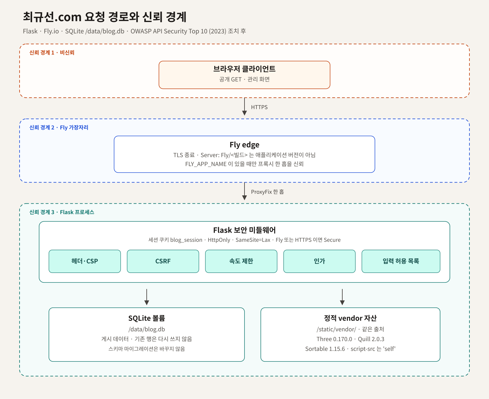

# OWASP API Security Top 10 (2023) 검토와 대응

최규선.com에 OWASP API Security Top 10 (2023)을 적용한 검토와 조치 기록임. 블로그는 Flask이고 Fly.io에 있으며, 저장소 이름은 `choigyuseon-security-project`, 데이터 파일은 SQLite `/data/blog.db`임.

- 근거는 KSProject pull request #37임. 병합 커밋은 `a62efc8990aae8d2025d93d2015e2ef9aaea62a3`임
- pull request #38에서 CSP `img-src`에 글 8–13이 쓰는 `https://raw.githubusercontent.com`을 넣음
- 범위는 이 저장소의 공개 페이지와 관리자 라우트임. 게시글 본문과 DB 데이터는 바꾸지 않음
- 판정은 양호 / 위험 / 취약임. 조치는 일반 방문과 정상 관리 흐름을 유지한 상태에서 적용함
- 전문은 [docs/review.md](docs/review.md)에 둠

## 구성



그림 원본은 [docs/architecture.svg](docs/architecture.svg)임. PNG는 Noto Sans CJK KR로 그림.

요청은 브라우저에서 Fly 가장자리를 지나 Flask로 들어옴. Flask 보안 미들웨어가 헤더·CSP, CSRF, 속도 제한, 인가, 입력 허용 목록을 본 뒤 SQLite 볼륨과 `/static/vendor/`에 닿음. 파선은 신뢰 경계임.

## 엔드포인트

공개 라우트는 읽기 전용임.

| 메서드 | 경로 | 역할 |
| --- | --- | --- |
| GET | `/` | 홈, 최근 글 8건 |
| GET | `/category/<slug>` | 카테고리와 하위 글 |
| GET | `/posts/<int:post_id>` | 공개 글 상세 |
| GET | `/robots.txt` | 수집 정책 |
| GET | `/sitemap.xml` | 공개 URL 목록 |
| GET | `/health` | 상태 `{status: ok}` |
| GET | `/static/<path>` | 정적 파일 |

관리자 라우트는 세션이 있는 단일 관리자만 사용함. JSON 엔드포인트는 카테고리 정렬 한 곳임.

| 메서드 | 경로 | 역할 |
| --- | --- | --- |
| GET, POST | `/admin/login` | 로그인 |
| POST | `/admin/logout` | 로그아웃 |
| GET | `/admin/` | 대시보드 |
| GET, POST | `/admin/posts/new` | 새 글 |
| GET, POST | `/admin/posts/<int:post_id>/edit` | 글 수정. 비공개 글 포함 |
| POST | `/admin/posts/<int:post_id>/delete` | 글 삭제 |
| POST | `/admin/categories` | 카테고리 추가 |
| POST | `/admin/categories/reorder` | 정렬 JSON |
| POST | `/admin/categories/<int:category_id>` | 카테고리 수정 |
| POST | `/admin/categories/<int:category_id>/delete` | 카테고리 삭제 |
| POST | `/admin/uploads/image` | 이미지 업로드 |

저장소에만 있고 라우트가 없는 템플릿은 `/security`, `/admin/fly-billing`, `admin_posts.html`임. 운영 사이트에서 `/security`는 404임.

## 조치 전후

| 항목 | 조치 전 | 조치 후 |
| --- | --- | --- |
| API1 BOLA | 위험(낮음). 공개 조회는 게시 글만 반환하나, 세션은 `admin_ok` 불리언뿐이었음 | 양호. 세션을 `ADMIN_USERNAME`에 묶고 없는 글은 404 |
| API2 인증 | 취약. 로그인 무제한, 공개 기본 서명 키, 세션 고정 가능 | 조치. 실패 8회/10분 잠금, 로그인 시 세션 재발급, Fly에서 공개 기본 키 미사용 |
| API3 BOPLA | 위험. 추가 JSON·폼 필드를 거부하지 않고 무시함 | 양호. 필드 허용 목록 밖은 400 또는 저장 거부 |
| API4 자원 소모 | 취약. 본문 상한 10MB뿐이고 로그인·JSON 속도 제한이 없음 | 조치. JSON 64KB, 정렬 500건, 로그인·API 속도 제한, 제목·이름·본문 길이 제한 |
| API5 BFLA | 취약. 정렬만 CSRF이고 나머지 관리 기능은 세션 쿠키만으로 호출 가능 | 양호. 관리 변경 요청 전부에 계정 확인과 CSRF |
| API6 민감 흐름 | 취약. 로그인 대입과 게시·삭제·업로드가 CSRF에 열려 있음 | 조치. 로그인 잠금과 상태 변경 CSRF. 화면의 숨은 필드로 기존 조작은 유지 |
| API7 SSRF | 양호. 서버가 외부 URL을 요청하지 않음 | 양호. `require_outbound_url` 허용 목록을 추가함 |
| API8 설정 | 취약. 보안 헤더 없음, 버전 헤더, 액션 `@master`, 디버그 강제 종료 없음 | 조치. CSP·HSTS·쿠키 속성, 디버그 끔, 버전 헤더 제거, 액션 SHA 고정 |
| API9 인벤토리 | 위험(낮음). JSON 라우트 목록이 테스트로 고정되어 있지 않음 | 양호. 라우트 맵을 테스트로 잠금. 없는 옛 경로는 404 유지 |
| API10 외부 API | 취약. jsDelivr 스크립트에 SRI 없음, 의존성 전이 패키지 미고정 | 조치. 프런트 자산을 저장소에 고정, Python 의존성 `==` 고정, 서버 반출 허용 목록 |

정상 방문자의 HTML 본문, 글 주소, 사이트맵, 관리자의 글 저장·카테고리 정렬 결과는 같음. 달라진 표면은 응답 헤더, 스크립트 출처(같은 버전의 Three/Quill/Sortable을 `/static/vendor/`에서 제공), 관리 폼의 CSRF 숨은 필드임. 배포 직후 관리자는 쿠키 이름이 `blog_session`으로 바뀌어 한 번 다시 로그인함. 로그인 유지 시간은 8시간임.

## API1. Broken Object Level Authorization

- 개념: 객체 식별자로 데이터에 닿는 기능마다 그 객체에 대한 인가를 확인해야 함. 식별자만으로 다른 객체에 닿으면 깨진 객체 수준 인가임
- 위험한 이유: 비공개이거나 다른 소유자의 객체가 번호 변경만으로 열릴 수 있음
- 적용(조치 전): 위험(낮음). 대상은 `GET /posts/<id>`, `GET /category/<slug>`, `GET|POST /admin/posts/<id>/edit`, `POST /admin/posts/<id>/delete`, `POST /admin/categories/<id>`, `POST /admin/categories/<id>/delete`, `POST /admin/categories/reorder`임. `get_post`는 `include_unpublished`가 아니면 `published=1`만 조회함. 비공개 글은 404이고 본문을 돌려주지 않음. 관리 객체 접근은 `session["admin_ok"]`만 확인해서, 플래그만 있으면 모든 글·카테고리 ID에 도달함. 계정이 하나라 사용자 간 가로 월권은 없으나 ID가 순번이라 존재 여부는 추측할 수 있음
- 대응(조치 후): 양호. `admin_session_ok()`가 `admin_ok`와 `admin_user == ADMIN_USERNAME`을 `hmac.compare_digest`로 확인한 뒤에만 객체를 읽고 씀. 없는 글 수정은 404임. 비로그인 삭제는 302로 로그인에 보내고 DB는 그대로 둠
- 확인: `test_api1_unpublished_object_is_hidden_and_admin_can_open_it`

## API2. Broken Authentication

- 개념: 인증이 잘못 붙으면 세션이나 토큰을 맡거나, 다른 자격으로 붙을 수 있음
- 위험한 이유: 실패 횟수가 없는 로그인, 공개된 서명 키, 고정된 세션은 관리자 세션을 열 수 있음
- 적용(조치 전): 취약. 대상은 `GET|POST /admin/login`, `POST /admin/logout`, 세션 쿠키임. 비밀번호 비교는 `hmac.compare_digest`로 되어 있었음. 다만 `FLASK_SECRET_KEY`가 없으면 `change-this-secret-before-deploying`으로 쿠키를 서명함. 로그인 실패 횟수 제한이 없고, 로그인 성공 시 세션을 비우지 않음. `Secure`는 프로세스 기동 시점의 `FLY_APP_NAME`에만 묶여 있음
- 대응(조치 후): 조치 완료. 로그인 실패 8회/10분/IP 이후 429와 `Retry-After: 60`임. 성공 시 해당 IP 집계를 지움. 아이디와 비밀번호를 둘 다 상수 시간에 비교함. 성공 시 `session.clear()` 후 `admin_ok`, `admin_user`를 다시 넣음. Fly에서 키가 없거나 예전 공개 기본값이면 그 값으로 서명하지 않음. 공개 페이지는 기동을 유지함. 쿠키는 `HttpOnly`, `SameSite=Lax`, 이름 `blog_session`임. Fly 또는 HTTPS이면 `Secure`임. 수명은 8시간임. `next`는 스킴·외부 호스트·`/admin` 밖 경로를 버리고 대시보드로 보냄. 로그인 POST도 CSRF 토큰을 요구함. 잔여는 IP를 나눠 시도하는 대입임. 계정은 하나이고 잠금은 프로세스 메모리 기준임
- 확인: `test_api2_login_locks_rotates_session_and_rejects_open_redirect`, `test_api2_fly_cookie_is_secure_and_secret_is_not_the_public_default`

## API3. Broken Object Property Level Authorization

- 개념: 객체 속성마다 읽기와 쓰기를 가리지 않으면 초과 노출이나 대량 할당이 됨
- 위험한 이유: 요청에 실린 추가 속성이 클라이언트가 정하면 안 되는 값을 바꿀 수 있음. 이 블로그의 정렬은 이름·슬러그까지 바꾸지는 못했고, 알 수 없는 필드를 거부하지 않은 점이 위험 판정이었음
- 적용(조치 전): 위험. 대상은 `POST /admin/categories/reorder`, 글·카테고리 폼, `POST /admin/uploads/image`임. 정렬 함수는 `id`, `parent_id`, `sort_order`만 읽어서 대량 할당으로 이름이나 슬러그를 바꾸지는 못했음. 알 수 없는 필드를 거부하지는 않음. 폼도 지정 키만 읽어 추가 키를 무시함
- 대응(조치 후): 양호. 정렬 JSON 최상위는 `items`, `csrf_token`만 허용함. 각 항목은 `id`, `parent_id`, `sort_order`만 허용함. 글 폼은 `title`, `category_id`, `body_html`, `published`, `csrf_token`임. 카테고리 폼은 `name`, `parent_id`, `csrf_token`임. 삭제는 `csrf_token`임. 업로드는 파일 `image`와 `csrf_token`만 허용함
- 확인: `test_api3_and_api5_reject_extra_fields_and_missing_csrf`

## API4. Unrestricted Resource Consumption

- 개념: 요청의 크기·횟수·연산에 상한이 없으면 자원을 제한 없이 씀
- 위험한 이유: 로그인·정렬·업로드가 반복되면 프로세스와 저장이 묶일 수 있음
- 적용(조치 전): 취약. 대상은 `POST /admin/login`, `POST /admin/categories/reorder`, `POST /admin/uploads/image`, `POST /admin/posts/new`, `POST /admin/categories`임. `GET /health`는 제한하지 않음. `MAX_CONTENT_LENGTH` 10MB만 있음. 로그인·정렬·업로드에 속도 제한이 없음. 제목·카테고리 이름·본문·정렬 건수에 서버 상한이 없음
- 대응(조치 후): 조치 완료. 정렬 JSON 64KB 초과는 413임. 정렬 항목 500건 초과는 400임. 관리 JSON·업로드는 IP당 60회/분이고 초과 시 429임. 로그인 실패는 8회/10분임. 제목 160자, 카테고리 이름 40자, 본문 1,000,000자임. 기존 행은 읽기만 하고 다시 쓰지 않음. 폼 비파일 필드 1MB, 파트 20개임. 전체 요청은 10MB를 유지해서 정상 이미지 업로드 한도는 같음. gunicorn은 `limit_request_line` 4094, 헤더 40개, 타임아웃 30초, 워커 1, 스레드 2임. 공개 HTML GET은 제한하지 않음. 검색 로봇과 일반 방문을 막지 않기 위함임. 잔여는 속도 제한이 프로세스 메모리라 머신이 늘면 버킷이 나뉜다는 점임. 현재 Fly 설정은 머신 1, 워커 1임
- 확인: `test_api4_limits_login_json_and_body_size`

## API5. Broken Function Level Authorization

- 개념: 기능 단위 인가가 없으면 일반 요청이 관리 기능을 실행함
- 위험한 이유: 관리 변경이 세션 플래그만으로 열리면, 그 세션을 가진 브라우저가 의도하지 않은 변경을 실행할 수 있음
- 적용(조치 전): 취약. 대상은 관리자 변경 라우트 전부임. 공개 GET은 기능 수준에서 읽기만 허용함. `@required`가 세션 플래그만 봄. CSRF는 `POST /admin/categories/reorder`에만 있음. 같은 사이트에 로그인된 브라우저로 삭제·게시·업로드·로그아웃·카테고리 변경을 호출할 수 있음
- 대응(조치 후): 양호. `admin_required`가 계정 일치와, POST/PUT/PATCH/DELETE의 CSRF를 함께 봄. 비로그인 요청은 302로 `/admin/login`에 보내고 데이터를 바꾸지 않음. CSRF 실패의 JSON·업로드는 400 `잘못된 요청입니다.`이고, 폼은 대시보드로 되돌림
- 확인: `test_api3_and_api5_reject_extra_fields_and_missing_csrf`, `tests/test_categories.py`의 정렬 인증 테스트

## API6. Unrestricted Access to Sensitive Business Flows

- 개념: 로그인, 공개, 삭제처럼 업무에 민감한 흐름은 자동화와 남용을 막아 둔 뒤에 열어야 함
- 위험한 이유: 잠금 없는 로그인과, 세션만 있으면 되는 게시·삭제가 관리 상태를 바꿈
- 적용(조치 전): 취약. 대상은 로그인, 글 공개·비공개 저장, 글 삭제, 카테고리 추가·수정·삭제·정렬, 이미지 업로드임. 로그인에 잠금이 없음. 게시와 삭제는 관리 세션만 있으면 다른 사이트에서 폼 제출로 실행할 수 있음. 정렬만 토큰이 있음
- 대응(조치 후): 조치 완료. API2의 로그인 잠금과 API5의 CSRF를 이 흐름에 적용함. 대시보드·편집기·로그인 폼이 토큰을 넣어 기존 버튼 동작은 유지됨. 삭제의 `confirm`은 `data-confirm`과 같은 페이지 스크립트로 옮겨 CSP와 함께 동작함. 재인증 비밀번호 창은 넣지 않음. 관리 화면 단계를 늘리지 않기 위함임
- 확인: `test_api6_publish_flow_requires_csrf_and_still_publishes`

## API7. Server Side Request Forgery

- 개념: 서버가 사용자가 준 URL을 검증 없이 가져가면 서버 측 요청 위조임
- 위험한 이유: 서버가 내부 주소나 메타데이터 주소를 대신 열 수 있음
- 적용(조치 전): 양호. 대상은 서버 코드 전체임. 글 HTML의 `a href`, `img src`는 브라우저에서만 쓰임. `urlopen`, `requests`, `httpx` 호출이 없음. 이미지 저장은 `/static/uploads/`만 허용하는 기존 새니타이저를 유지함. 서버가 글 안의 URL을 가져가지 않음
- 대응(조치 후): 양호. `hardening.outbound_url_allowed`는 `https://fonts.googleapis.com`, `https://fonts.gstatic.com`만 허용함. 사용자 정보, http, 메타데이터 주소, 다른 호스트는 거부함. `require_outbound_url`이 이후 서버 반출의 유일한 통과점임. 글 렌더 규칙은 바꾸지 않음
- 확인: `test_api7_outbound_allowlist_blocks_metadata_and_private_urls`

## API8. Security Misconfiguration

- 개념: 응답 헤더, 디버그, 서버 표기, 배포 액션의 잠금이 빠지면 설정이 어긋남
- 위험한 이유: 프레임 삽입, 콘텐츠 스니핑, 디버그 출력, 버전 표기, 고정되지 않은 액션이 공격 면을 넓힘
- 적용(조치 전): 취약. 대상은 모든 응답, 쿠키, gunicorn, 개발 서버, GitHub Actions임. 관리 경로의 `X-Robots-Tag` 외 보안 헤더가 없음. `debug=True`를 코드에서 끄지 않음. gunicorn이 서버 헤더를 붙일 수 있고, 개발 서버는 `Werkzeug/<버전>`을 붙임. `flyctl` 액션이 `@master`임. 쿠키 `Secure`가 기동 시점 환경에만 의존함
- 대응(조치 후): 조치 완료. `Content-Security-Policy`(스크립트는 `'self'`와 요청별 nonce), `X-Content-Type-Options: nosniff`, `X-Frame-Options: DENY`, `Referrer-Policy`, `Permissions-Policy`, `Cross-Origin-Opener-Policy`, `X-Permitted-Cross-Domain-Policies: none`을 붙임. `img-src`는 `'self'`, `data:`, `blob:`와 `https://raw.githubusercontent.com`만 허용함. 그 외 이미지 호스트는 넣지 않음. Fly 또는 HTTPS에서 `Strict-Transport-Security: max-age=31536000; includeSubDomains`와 CSP `upgrade-insecure-requests`를 붙임. 관리 응답은 `Cache-Control: no-store`, `Referrer-Policy: no-referrer`, 기존 `X-Robots-Tag: noindex, nofollow`를 유지함. `app.debug`를 매 요청 거짓으로 고정함. `python app.py`는 `debug=False`임. 500은 `일시적인 오류가 발생했습니다.`만 반환함. gunicorn 응답에서 `Server` 헤더를 제거함. 개발 서버 `version_string`은 `web`임. `FLY_APP_NAME`이 있을 때만 `ProxyFix` 한 홉을 믿음. 속도 제한 IP가 Fly 프록시 주소로 뭉개지지 않게 함. 업로드는 확장자와 PNG/JPEG/GIF/WEBP 시그니처가 둘 다 맞을 때만 저장함. 잔여로 Fly 가장자리가 `Server: Fly/<빌드>`를 붙임. 애플리케이션 버전은 아님. Quill이 요소 스타일을 써서 `style-src`에 `'unsafe-inline'`이 남아 있음. 스크립트에는 `'unsafe-inline'`과 `'unsafe-eval'`을 넣지 않음
- 확인: `test_api8_security_headers_debug_and_image_signature`

## API9. Improper Inventory Management

- 개념: 떠 있는 경로, 문서, 버전이 서로 다르면 목록 밖 API가 남음
- 위험한 이유: 문서에 고정되지 않은 관리 JSON이나, 라우트가 없는 옛 화면이 호출 대상으로 남을 수 있음
- 적용(조치 전): 위험(낮음). 대상은 Flask URL 맵, `/health`, 라우트되지 않은 템플릿임. 공개 문서에 관리 JSON 한 건이 목록으로 고정되어 있지 않음. `/security`, `/admin/fly-billing` 템플릿이 남아 있으나 라우트가 없어 운영에서는 404임. 옛 `/api/v1` 같은 그림자 API는 없음
- 대응(조치 후): 양호. `test_api9_route_inventory_matches_the_blog`가 라우트와 메서드를 현재 집합과 같게 유지함. 정렬 URL은 관리 화면이 이미 쓰는 `/admin/categories/reorder` 그대로 둠. 버전 경로를 새로 열어 인벤토리를 늘리지 않음. `/health`는 버전 없는 `{status: ok}`만 반환함. 잔여로 쓰이지 않는 템플릿 파일은 삭제하지 않음. 콘텐츠와 무관한 라우트를 되살리지 않기 위함임
- 확인: `test_api9_route_inventory_matches_the_blog`

## API10. Unsafe Consumption of APIs

- 개념: 제3자 스크립트, 글꼴, 빌드 액션, 패키지를 검증 없이 받으면 그 공급망을 그대로 실행함
- 위험한 이유: SRI 없는 CDN 스크립트나 고정되지 않은 액션·의존성이 바뀌면 페이지와 배포가 같이 바뀜
- 적용(조치 전): 취약. 대상은 브라우저가 받던 jsDelivr(Sortable 1.15.6, Quill 2.0.3, Three 0.170.0), Google Fonts, GitHub Actions, pip 의존성임. 관리 화면과 홈이 CDN 스크립트를 SRI 없이 로드함. 서버가 제3자 API를 호출하지는 않음. `setup-flyctl`이 `@master`임. `requirements.txt`는 Flask와 gunicorn만 고정함
- 대응(조치 후): 조치 완료. 위 세 라이브러리를 `static/vendor/`에 같은 버전으로 둠. 홈 import map과 관리 편집기가 이 파일을 봄. 로컬 헤드리스 확인에서 교량 장면이 `scene-ready`까지 올라옴. CSP `script-src`에 CDN 호스트가 없음. 글꼴은 기존 `@import`를 유지하고 CSP에서 `fonts.googleapis.com`, `fonts.gstatic.com`만 허용함. `actions/checkout`, `actions/setup-python`, `setup-flyctl`을 커밋 SHA로 고정함. Flask 3.1.1, gunicorn 23.0.0과 전이 의존성을 `==`로 고정함. gunicorn 주 버전은 올리지 않음. 잔여로 브라우저가 Google Fonts를 계속 요청함. 사용자 본문을 그 API에 보내지 않음. 서버 측 반출은 API7 허용 목록을 통과해야 함
- 확인: `test_api10_dependencies_and_workflows_are_pinned`, `test_api7_outbound_allowlist_blocks_metadata_and_private_urls`, `test_api8_security_headers_debug_and_image_signature`

## 블로그 검증

- 추가한 테스트는 `tests/test_owasp_api.py`임. 항목마다 우회가 막히고, 토큰이 있는 게시·카테고리 추가는 성공함
- 기존 `tests/test_categories.py` 로그인이 로그인 페이지의 CSRF를 포함함. Sortable 경로는 로컬 파일로 확인함. `tests/test_seo.py`의 공개 메타·사이트맵 기대는 유지됨
- CI는 pull request의 `Tests`, `main` 배포 워크플로의 테스트 잡이 `tests.test_categories`, `tests.test_seo`, `tests.test_owasp_api`를 실행함. 배포 잡은 테스트 성공 뒤에만 `flyctl deploy`를 실행함
- 저장소에 남아 있는 `tests/test_admin.py`, `tests/test_security_decks.py`는 라우트가 없는 Fly 비용 화면과 `/security`를 기대함. 운영도 404이므로 그 라우트를 다시 열지 않았고, 이번 CI 대상에서도 제외함

## 데이터

- `content.py`의 스키마 마이그레이션은 바꾸지 않음
- 길이 제한은 새 저장 요청에만 적용됨. 기존 행을 다시 쓰지 않음
- 검토용 테스트는 임시 SQLite를 쓰고 `static/uploads`에 만든 시험 이미지는 삭제함

## 점검 도구 api-sec-check

이 저장소의 `api-sec-check`는 대상 URL을 읽기 전용으로 봄. 기대값은 위 조치 후 기준임. 기본 실행은 로그인 요청을 보내지 않음.

보는 항목은 다음과 같음.

- 보안 헤더와 CSP, HTTPS일 때 HSTS `max-age=31536000; includeSubDomains`와 `upgrade-insecure-requests`
- `script-src`의 `'self'`와 nonce, 스크립트의 `'unsafe-inline'`·`'unsafe-eval'`·외부 출처 없음
- `img-src`의 `'self'`, `data:`, `blob:`, `https://raw.githubusercontent.com`
- 글꼴 호스트가 `fonts.googleapis.com`, `fonts.gstatic.com` 안인지
- `GET /admin/login`의 `Cache-Control: no-store`, `Referrer-Policy: no-referrer`, `X-Robots-Tag: noindex, nofollow`
- 쿠키 이름 `blog_session`, `HttpOnly`, `SameSite=Lax`, HTTPS이면 `Secure`
- `Server`에 Werkzeug·gunicorn·버전 숫자가 없는지. `Server: Fly/<빌드>`는 검토 잔여라 주의로 둠
- `GET /health` 본문이 `{"status":"ok"}`인지
- CSRF 토큰 없는 `POST /admin/logout`, `POST /admin/posts/1/delete`, `POST /admin/categories/reorder`가 302 로그인 또는 400·401·403으로 거부되는지
- `--login-test`가 있을 때만, 없는 계정과 고정 오답으로 429와 `Retry-After: 60`을 보는지. 기본 9회, 상한 12회이고 429가 나오면 멈춤

`style-src`의 `'unsafe-inline'`은 검토가 남긴 잔여라 주의임. 주의와 건너뜀은 종료 코드를 올리지 않음. 미충족이 없으면 0, 있으면 1, 인자가 잘못되면 2임. 표준 출력에 한국어 보고서와 JSON을 이어서 찍음.

```bash
python -m pip install -e ".[test]"
api-sec-check https://xn--9h0bj97ao2i.com
python -m pytest
```

로그인 잠금까지 보려면 `api-sec-check https://xn--9h0bj97ao2i.com --login-test`임. `https://xn--9h0bj97ao2i.com`은 최규선.com의 호스트임.

이 저장소의 CI는 Python 3.11과 3.12에서 `pytest`를 실행함. `actions/checkout`과 `actions/setup-python`은 커밋 SHA로 고정함.
